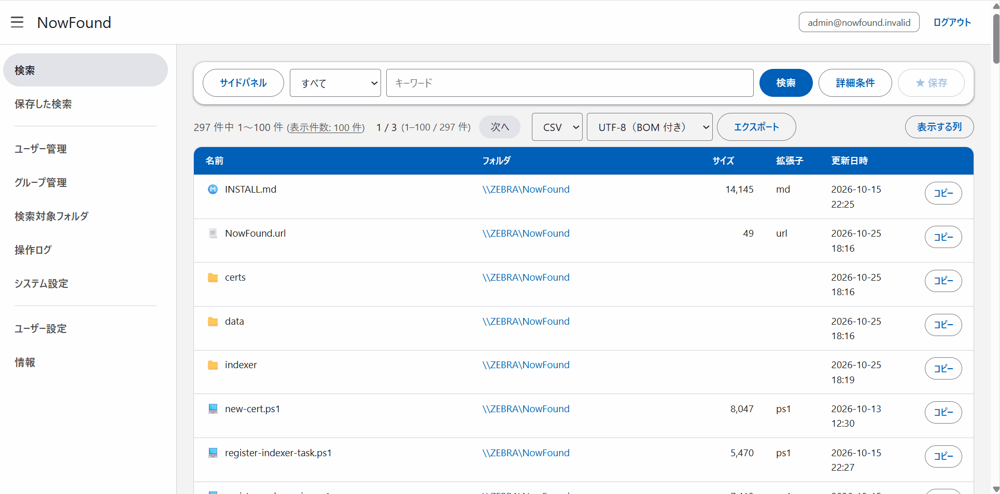

# NowFound

フォルダ配下のファイル名・フォルダ名を高速に検索する、オンプレミス向けの Web アプリケーションです。
外部 CDN やクラウドサービスに依存せず、オフライン環境でも動作します。

伝統的な日本企業で構築されているWindowsファイルサーバーで使うと便利だろうというイメージで作っております。





## 製品説明

NowFound は 2 つのプログラムで構成されます。

| プログラム | 役割 |
|---|---|
| Web コンソール | メイン |
| Indexer | ファイル情報のデータベース（`files.db`）を差分更新 |


## 技術スタック

| 区分          | 採用技術                        |
| ------------- | ------------------------------- |
| Runtime       | .NET 10 (C# 14)                 |
| Web Framework | ASP.NET Core MVC                |
| ORM           | Entity Framework Core 10        |
| Database      | SQLite 3                        |
| Frontend 言語 | ES2020 JavaScript（Vanilla JS） |


## 機能

- ファイルの検索

- ユーザー管理

- ActiveDirectory 認証

- グループによるアクセス制御

- 検索対象フォルダの設定

- 検索ブックマーク

- 操作ログ

  

## インストール

事前に .NET 10 ランタイム（ASP.NET Core）をインストールしてください。

### Windows

`NowFound-Setup-<バージョン>.exe` を管理者権限で実行します。Web サービス（HTTPS 5002）と、毎日 05:30 の Indexer タスクがタスクスケジューラに登録されます。同じインストーラーを実行すればアップデートになります。

```powershell
.\register-web-service.ps1 -Seed   # Web をサービス登録（初回のみ -Seed で初期管理者を作成）
.\register-indexer-task.ps1        # Indexer をタスクスケジューラに登録
```


### インストール後

1. 検索対象フォルダ

   * 検索を行う検索対象フォルダを追加します

   * 検索対象フォルダが共有フォルダの場合は`共有フォルダ`にチェックを入れると、パスは`\\{Computername}\{ShareName}`形式に差し替えます

2. グループ管理
   * グループを作成して、メンバーと閲覧可能な検索対象フォルダを設定します
3. Indexer (ファイル情報更新)
   * Windowsのタスクスケジューラを起動します
   * `NowFound Indexer (Daily Full)`と`NowFound Indexer (Hourly)`のタスクがあります
   * 初回は`NowFound Indexer (Daily Full)`を実行してください


### 初回ログイン

`https://<サーバー名>:5002` にアクセスし、初期管理者でログインします。

| 項目 | 値 |
|---|---|
| アカウント | `admin@nowfound.invalid` |
| パスワード | `password123!` |

初回ログイン時にパスワード変更が求められます。ネットワークに公開する前に、必ず変更してください。

その後、管理者画面で検索対象フォルダを登録し、Indexer の実行後に検索できるようになります。

HTTPS 証明書の差し替えなど、詳細は [deploy/INSTALL.md](deploy/INSTALL.md) を参照してください。
